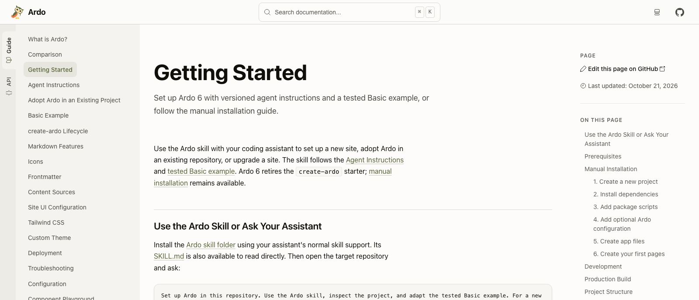

Ardo 6 verändert, wie eine Dokumentationswebsite ihre Leser erreicht. Jede Seite
wird als vollständiges HTML-Dokument gebaut. Guides, API-Referenz und Suchdaten
entstehen vor dem Deployment. Das Ergebnis lässt sich auf einem statischen
Host ausliefern.

Für Autoren bleibt der Einstieg vertraut: Markdown oder MDX schreiben,
React-Komponenten einbinden und die Website neben dem beschriebenen Code
pflegen. Dieses Release macht den Weg dorthin direkter.

## Ein Dokument bei jedem Aufruf

Ardo 6 entfernt React Router aus der Website-Architektur. Ein Seitenlink lädt
ein neues Dokument. Dessen HTML enthält bereits den angefragten Inhalt,
einschließlich hervorgehobener Codeblöcke und generierter API-Beschreibungen.
Interaktive Beispiele und Website-Bedienelemente laufen nach der Hydration
weiterhin mit React.

Auch die Einrichtung ändert sich: Ardo verwaltet passende Versionen von React,
React DOM und Vite. Ein Dokumentationsprojekt verwendet Ardos React-Einstiegspunkte
und JSX-Konfiguration und muss dadurch weniger Framework-Abhängigkeiten selbst
aufeinander abstimmen.

## Native Werkzeuge übernehmen die Vorbereitung

Ferromark kompiliert Markdown und MDX zu React-Modulen. Ferriki hebt Codeblöcke
während der Kompilierung hervor und bereitet die Farben für den hellen und
dunklen Modus vor. Beides geschieht, bevor ein Leser die Seite öffnet.

Auch die API-Referenz ist neu aufgebaut. Ardo liest TypeScript-Exporte über den
nativen TypeScript-Compiler und erstellt die Referenz selbst. Das ersetzt die
TypeDoc-Integration. Komponenten und ihre Props gehören zusammen; Signaturen,
Parameter und Kommentare werden zu durchsuchbaren Seiten. Für diese Analyse
verwendet das Release eine festgelegte Nightly-Version von TypeScript 7.

Der [Benchmark-Bericht zum Release](https://github.com/sebastian-software/ardo/blob/ardo-v6.0.0/docs/reports/2026-10-29-release-benchmark.md)
beschreibt die gemessenen Aufgaben, den Rechner und die Grenzen der
veröffentlichten Zeitmessungen.

## Auch der Website-Rahmen ist React

Header, Sidebars und Footer lassen sich als Kinder von `ArdoRoot` zusammensetzen.
Theme, Logo und Icon werden in JSX übergeben. Gestaltung und Layout liegen damit
dort, wo React-Entwickler ohnehin mit Komponenten arbeiten.

Dazu kommen viele Verbesserungen beim Lesen: Suchergebnisse zeigen Textauszüge,
der schmale Header lässt dem Inhalt mehr Platz, und der Build prüft interne
Links und Sprungmarken im erzeugten HTML. Ardos eigene Guides gibt es jetzt auf
Englisch, Deutsch, Französisch und Spanisch. Palamedes verwaltet ihre
Übersetzungen aus einer gemeinsamen englischen Quelle.

## Eine bestehende Website auf v6 umstellen

Dies ist ein Major-Release. Router-Einstiegsdateien und die zugehörige
Konfiguration entfallen, die native API-Generierung ersetzt die
TypeDoc-Konfiguration, und Theme-Einstellungen wandern zu `ArdoRoot`.
Voraussetzung ist Node.js 22.22 oder neuer.

Der [Upgrade-Guide für v6](/de/guide/releases/upgrade-to-v6) führt durch die
Umstellung. Für eine neue Website beginnt der Weg bei
[Erste Schritte](/de/guide/getting-started). Die
[vollständigen Release Notes zu v6.0](https://github.com/sebastian-software/ardo/releases/tag/ardo-v6.0.0)
enthalten alle einzelnen Änderungen und entfernten Funktionen.
