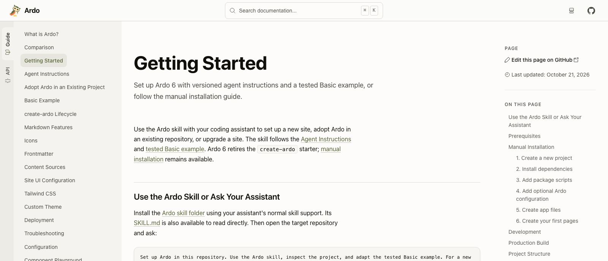

Ardo 6 changes how a documentation site reaches its readers. Every page is built
as a complete HTML document. Guides, API reference pages, and search data are
prepared before deployment, so the result can live on a static host.

For authors, the starting point stays familiar: write Markdown or MDX, bring in
React components, and keep the site beside the code it explains. The work in
this release is in making that path more direct.

## A document on every request

Ardo 6 removes React Router from the site architecture. Following a page link
loads a new document. The requested content is already in its HTML, including
highlighted code and generated API descriptions. React still powers interactive
examples and site controls after hydration.

That also changes the project setup. Ardo owns compatible versions of React,
React DOM, and Vite. A documentation project uses Ardo's React entry points and
JSX configuration, with fewer framework dependencies to coordinate itself.

## Native tools do the preparation

Ferromark compiles Markdown and MDX into React modules. Ferriki highlights code
blocks during compilation, preparing both light and dark colors. Neither job
has to wait for a reader's browser.

The API reference has changed too. Ardo now reads TypeScript exports through
the native TypeScript compiler and builds the reference itself, replacing the
TypeDoc integration. Components and their props belong together; signatures,
parameters, and comments become searchable pages. This release uses a pinned
TypeScript 7 nightly for that analysis.

The [release benchmark report](https://github.com/sebastian-software/ardo/blob/ardo-v6.0.0/docs/reports/2026-10-29-release-benchmark.md)
records the measured workloads, machine, and limits behind the published timings.

## The site shell is React too

Headers, sidebars, and footers can be composed as children of `ArdoRoot`. Theme,
logo, and icon are passed in JSX. This puts the site's appearance and layout
where React developers already expect to work with components.

There are smaller reading improvements throughout: search results include
excerpts, the narrow header gives the content more room, and the build checks
internal links and fragments in the emitted HTML. Ardo's own guides are now
available in English, German, French, and Spanish, with Palamedes maintaining
translations from a shared English source.

## Moving an existing site to v6

This is a major release. Router entry files and configuration go away, native
API generation replaces TypeDoc configuration, and theme settings move to
`ArdoRoot`. Node.js 22.22 or newer is required.

The [v6 upgrade guide](/en/guide/releases/upgrade-to-v6) walks through those
changes. For a new site, start with [Getting Started](/en/guide/getting-started).
The [complete v6.0 release notes](https://github.com/sebastian-software/ardo/releases/tag/ardo-v6.0.0)
cover the individual changes and removals.
