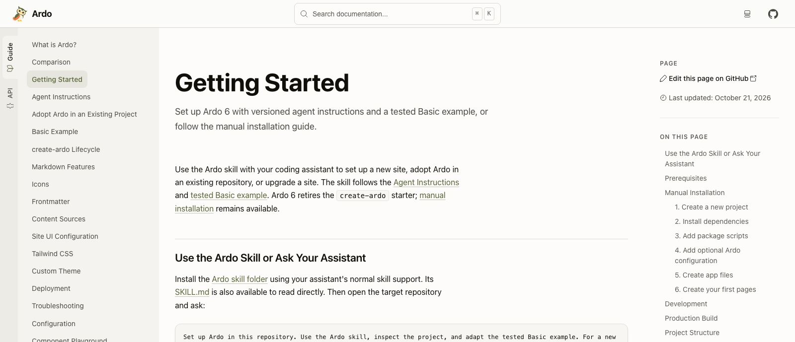

Ardo 6 cambia cómo llega una web de documentación a sus lectores. Cada página
se construye como un documento HTML completo. Las guías, la referencia de API y
los datos de búsqueda se preparan antes del despliegue. El resultado puede
servirse desde un alojamiento estático.

Para los autores, el punto de partida sigue siendo conocido: escribir Markdown
o MDX, incorporar componentes React y mantener el sitio junto al código que
explica. Esta versión hace ese recorrido más directo.

## Un documento en cada petición

Ardo 6 elimina React Router de la arquitectura del sitio. Seguir un enlace
carga un documento nuevo. Su HTML ya incluye el contenido solicitado, con los
bloques de código resaltados y las descripciones de API generadas. React sigue
ejecutando los ejemplos interactivos y los controles del sitio tras la
hidratación.

También cambia la configuración del proyecto. Ardo gestiona versiones
compatibles de React, React DOM y Vite. Un proyecto de documentación utiliza
los puntos de entrada de React y la configuración JSX de Ardo, con menos
dependencias del framework que coordinar por su cuenta.

## Herramientas nativas para preparar el contenido

Ferromark compila Markdown y MDX en módulos React. Ferriki resalta los bloques
de código durante la compilación y prepara los colores de los modos claro y
oscuro. Ambas tareas terminan antes de que llegue el lector.

La referencia de API también ha cambiado. Ardo lee las exportaciones de
TypeScript mediante su compilador nativo y construye la referencia,
sustituyendo la integración con TypeDoc. Los componentes y sus props se
presentan juntos; firmas, parámetros y comentarios se convierten en páginas
que aparecen en la búsqueda. Esta versión utiliza una nightly fijada de
TypeScript 7 para ese análisis.

El [informe de rendimiento de la versión](https://github.com/sebastian-software/ardo/blob/ardo-v6.0.0/docs/reports/2026-10-29-release-benchmark.md)
recoge las tareas medidas, el equipo y los límites de los tiempos publicados.

## La estructura del sitio también es React

Las cabeceras, barras laterales y pies de página se pueden componer como hijos
de `ArdoRoot`. El tema, el logotipo y el icono se pasan en JSX. Así, el aspecto y
la distribución del sitio se definen donde los desarrolladores React ya
trabajan con componentes.

También hay mejoras de lectura: los resultados de búsqueda muestran extractos,
la cabecera estrecha deja más espacio al contenido y la compilación comprueba
los enlaces internos y fragmentos del HTML generado. Las guías de Ardo están
ahora disponibles en inglés, alemán, francés y español, con Palamedes para
mantener las traducciones desde una fuente inglesa compartida.

## Migrar un sitio existente a v6

Esta es una versión mayor. Desaparecen los archivos de entrada y la
configuración del router, la generación nativa de API sustituye la
configuración de TypeDoc y los ajustes del tema pasan a `ArdoRoot`. Se requiere
Node.js 22.22 o una versión posterior.

La [guía de migración a v6](/es/guide/releases/upgrade-to-v6) detalla esos
cambios. Para un sitio nuevo, empieza por
[Primeros pasos](/es/guide/getting-started). Las
[notas completas de v6.0](https://github.com/sebastian-software/ardo/releases/tag/ardo-v6.0.0)
recogen cada cambio y cada función eliminada.
