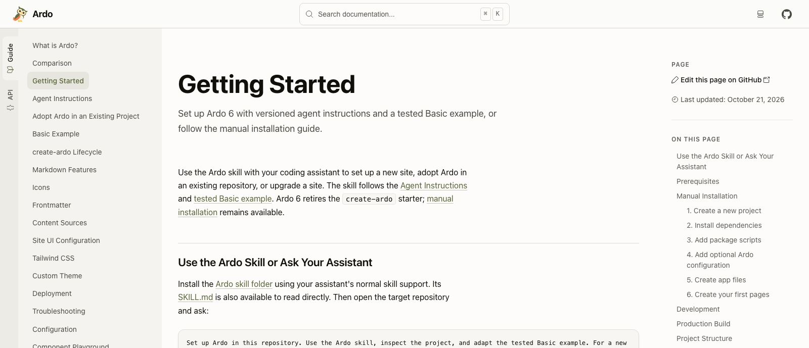

Ardo 6 change la façon dont une documentation arrive jusqu'à ses lecteurs.
Chaque page est construite comme un document HTML complet. Les guides, la
référence API et les données de recherche sont préparés avant le déploiement.
Le résultat peut être servi par un hébergement statique.

Pour les auteurs, le point de départ reste familier : écrire en Markdown ou
MDX, intégrer des composants React et conserver le site à côté du code qu'il
explique. Cette version rend ce parcours plus direct.

## Un document à chaque requête

Ardo 6 retire React Router de l'architecture du site. Suivre un lien charge un
nouveau document. Son HTML contient déjà le contenu demandé, y compris le code
coloré et les descriptions d'API générées. React continue de faire fonctionner
les exemples interactifs et les commandes du site après l'hydratation.

La configuration du projet évolue aussi. Ardo gère des versions compatibles de
React, React DOM et Vite. Un projet de documentation utilise les points
d'entrée React et la configuration JSX d'Ardo, avec moins de dépendances de
framework à coordonner lui-même.

## Des outils natifs pour la préparation

Ferromark compile Markdown et MDX en modules React. Ferriki colore les blocs de
code pendant la compilation et prépare les couleurs des thèmes clair et
sombre. Ces deux tâches sont terminées avant l'arrivée du lecteur.

La référence API a elle aussi changé. Ardo lit les exports TypeScript avec le
compilateur TypeScript natif et construit lui-même la référence, remplaçant
l'intégration TypeDoc. Les composants et leurs props sont réunis ; signatures,
paramètres et commentaires deviennent des pages consultables dans la recherche.
Cette version utilise une nightly TypeScript 7 figée pour cette analyse.

Le [rapport de benchmark de la version](https://github.com/sebastian-software/ardo/blob/ardo-v6.0.0/docs/reports/2026-10-29-release-benchmark.md)
décrit les tâches mesurées, la machine et les limites des temps publiés.

## La structure du site est aussi en React

En-têtes, barres latérales et pieds de page peuvent être composés comme enfants
de `ArdoRoot`. Le thème, le logo et l'icône sont passés en JSX. L'apparence et la
mise en page se trouvent ainsi là où les développeurs React travaillent déjà
avec leurs composants.

La lecture bénéficie également de nombreuses améliorations : les résultats de
recherche affichent des extraits, l'en-tête étroit laisse plus de place au
contenu et la compilation vérifie les liens internes et les fragments dans le
HTML produit. Les guides d'Ardo sont désormais disponibles en anglais,
allemand, français et espagnol, avec Palamedes pour gérer les traductions à
partir d'une source anglaise commune.

## Migrer un site existant vers v6

Il s'agit d'une version majeure. Les fichiers d'entrée et la configuration du
routeur disparaissent, la génération native des API remplace la configuration
TypeDoc et les paramètres de thème passent dans `ArdoRoot`. Node.js 22.22 ou
une version plus récente est nécessaire.

Le [guide de migration vers v6](/fr/guide/releases/upgrade-to-v6) détaille ces
changements. Pour un nouveau site, commencez par
[Premiers pas](/fr/guide/getting-started). Les
[notes complètes de v6.0](https://github.com/sebastian-software/ardo/releases/tag/ardo-v6.0.0)
présentent chaque changement et chaque suppression.
