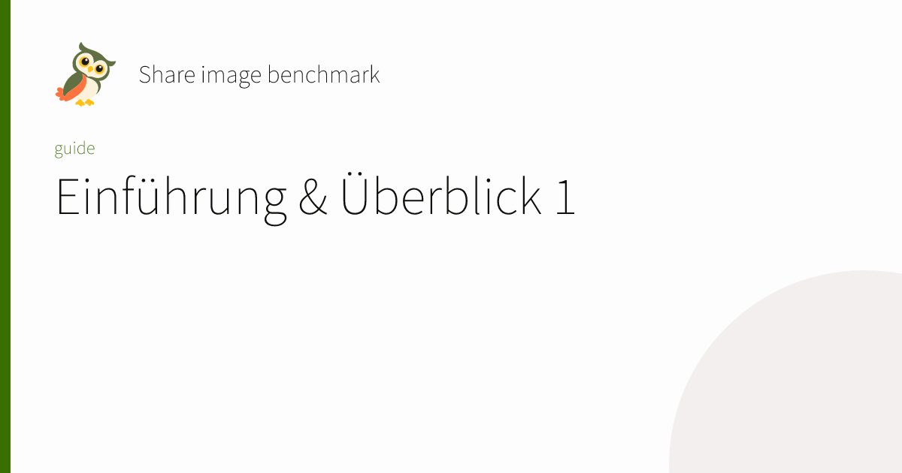

# Share-image build-cost check

Measured November 10, 2026 on the implementation for [#471](https://github.com/sebastian-software/ardo/issues/471), based on `1edc90f476d3c158101a4135889fbfc5b04ddabe`. The [raw report](./2026-11-10-share-images-benchmark.json) records source-tree, script, lockfile, and font hashes plus every timed sample.

| Mode              | Median complete CLI build |    Sample range | Generated cards |
| ----------------- | ------------------------: | --------------: | --------------: |
| Disabled          |                   1.940 s |   1.894–1.961 s |               0 |
| Enabled           |                  12.208 s | 12.197–12.331 s |             100 |
| Added median cost |                  10.268 s |               — |               — |

The enabled output contains 2,913,667 bytes of PNGs. Every card is 1200 × 630; the ordinary HTML build and native links still work without cards. Card generation, font paths, and templates stay out of browser JavaScript.

## Workload and method

The [harness](../../scripts/benchmark-share-images.mjs) copies the public Basic example into a temporary consumer project. It expands the real getting-started Markdown into 100 separately titled routes, 20 each in English, German, French, Spanish, and Japanese, plus five TSX home pages. It uses Ardo's actual owl logo and a JSX-owned green theme, with the default card template. This is a bounded fixture derived from the example, not the complete documentation website.

Each sample starts a fresh CLI process and includes configuration, client/server Vite builds, metadata, prerendering, link checking, and PNG output. Both modes get one unmeasured warmup. Three measured pairs alternate their order. Output assertions and sample-image copying happen after the timer stops. `buildTime` and `buildHash` are pinned; no source or dependency installation happens inside the timer. No competing repository builds or test suites ran during the measurement window. OS caches remain uncontrolled and generally warm.

The machine is an Apple M1 Ultra with 20 logical CPUs and 64 GiB RAM, macOS 27.0.0 arm64, Node v24.22.2. The font is the full variable [Noto Sans SC](https://github.com/google/fonts/tree/main/ofl/notosanssc), 17,772,300 bytes, family `Noto Sans SC`. Its exact source bytes are identified by SHA-256 in the raw report. The report does not distribute that full font.

Unlike the 72 KB renamed font subset used by the portable regression tests, this font contains a large CJK repertoire. Resvg loads/parses the explicit font files for each card; Ardo only resolves their paths once and never scans system fonts or downloads fonts. These figures therefore should not be generalized to a small Latin font, another template, a cold machine, or a larger site. Check the site's own font set and route count before enabling the option. The disabled path does not load card fonts or invoke the card renderer.

To repeat after `pnpm install` and `pnpm build`, supply your licensed local font file:

```sh
node scripts/benchmark-share-images.mjs \
  --font /path/to/NotoSansSC.ttf \
  --family "Noto Sans SC" \
  --artifacts /tmp/ardo-share-image-preview
```

## Rendered examples

These cards come from the enabled full-font benchmark. The English, German, and Japanese images were visually checked for actual text glyphs, logo placement, wrapping, and clipping. The font's default variable instance is thin; projects that need a particular weight should provide a matching static font face.





